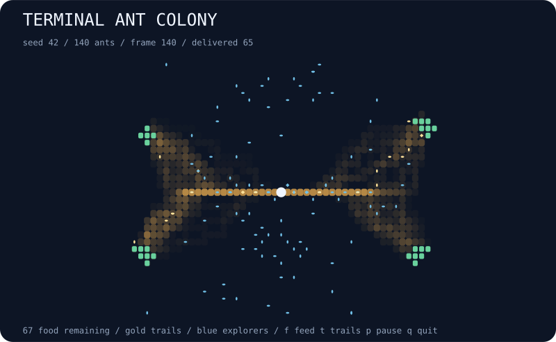

# terminal-ant-colony

Watch a seeded ant colony discover food, carry it home, and leave fading pheromone trails across your terminal.



## Run

```bash
npx --yes github:b69ca/terminal-ant-colony
npx --yes github:b69ca/terminal-ant-colony --seed 7 --ants 250
```

Node.js 20 or newer. No runtime dependencies. Everything runs locally.

## Play

| Key | Action |
| --- | --- |
| `p` / Space | Pause or resume |
| `.` | Pause and advance one tick |
| `f` | Add food to the four original patches |
| `t` | Toggle terminal pheromone trails |
| `n` | Start the next seed |
| `r` | Reset the current seed |
| `+` / `-` | Faster or slower display |
| `q` / Ctrl-C | Quit and restore the terminal |

`N` is the nest, `F` is food, `a` is an exploring ant, and `@` is an ant carrying food. Gold dots and colons show pheromone strength. Ants can share cells, so the visible ant count may be smaller than the colony size. The nest is always drawn on top.

Feeding adds three units to each patch cell, including cells that still have food. Ants continue exploring after all food is delivered; use `f` to keep the colony busy. Reset and next seed clear the current food, trails, and delivery count. `t` changes only terminal rendering; SVG always includes trails.

The live display fits the terminal at startup. Very small terminals may clip the minimum grid. Quitting restores the screen, cursor, and input mode. `--no-color` and `NO_COLOR=1` disable ANSI colors.

## Export

```bash
npx --yes github:b69ca/terminal-ant-colony --seed 42 --steps 140 --svg colony.svg
npx --yes github:b69ca/terminal-ant-colony --seed 42 --steps 400 --json
npx --yes github:b69ca/terminal-ant-colony --frames 200
```

| Option | Range / default |
| --- | --- |
| `--seed N` | 0–4294967295; default 42 |
| `--ants N` | 10–500; default 140 |
| `--width N` | 24–120; export default 80 |
| `--height N` | 16–60; export default 36 |
| `--steps N` | 0–10000; live default 0, export default 140 |
| `--frames N` | 0–100000; finite terminal session |
| `--json` | Print a summary |
| `--svg FILE` | Save a vector snapshot |
| `--no-color` | Disable terminal colors |
| `--help` | Show usage |

JSON and SVG can be combined; neither accepts `--frames`. Piped output shows at most one plain snapshot without escape sequences. A live session shows the initial state first and advances between frames; paused frames count toward a finite frame limit. Use explicit dimensions to reproduce a world across terminals. Exit codes: 0 success, 2 argument or file error.

## How it works

Four food patches are placed in separate quadrants with a local seeded PRNG. Ants start at the nest with seeded headings. Explorers take weighted cardinal random walks: they prefer continuing forward, nearby pheromone, and food detected within six Manhattan steps. Grid edges block movement.

A successful ant picks up one food unit and returns by reducing its Manhattan distance to the known nest coordinates. It deposits pheromone on its return path. Pheromone decays by 1.5% per tick and is capped at 30 per cell. Ants update in array order, so later ants can respond to deposits made earlier in the same tick. Exploration and returns are deterministic for the same dimensions, seed, colony size, and sequence of feeding actions.

This is an educational foraging toy with an open field and simplified homing behavior. There are no obstacles or pathfinding guarantees. Returning ants know the nest location; pheromone influences explorers rather than teaching ants how to navigate home.

JSON reports supplied food, remaining food, ants carrying food, delivered food, trail coverage, and maximum pheromone. Every food unit is either remaining, being carried, or delivered. Full particle and grid arrays are available through the library rather than the JSON summary.

## Library

Install with `npm install github:b69ca/terminal-ant-colony`, then:

```js
import { createWorld, step, feed, analyze, renderSVG } from 'terminal-ant-colony';
const world = createWorld({ seed: 42, width: 80, height: 36, ants: 140 });
step(world, 140); // Mutates and returns world.
console.log(analyze(world));
feed(world); // Adds food and updates the supplied total.
const svg = renderSVG(world);
```

`render(world, { color: false, trails: true })` returns a terminal snapshot. Use states from `createWorld`; changing dimensions, ants, nest, food, or internal arrays directly is unsupported.

## Development

```bash
npm ci
npm run check
```

Tests cover deterministic updates, food conservation, bounds, successful deliveries, pheromone decay, feeding, CLI errors, and exports. GitHub Actions runs on Node.js 20, 22, and 24.

## License

MIT
